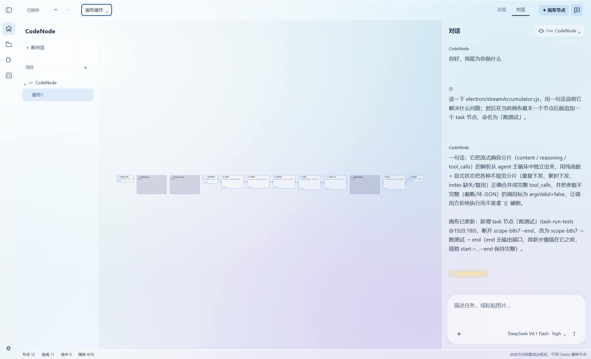
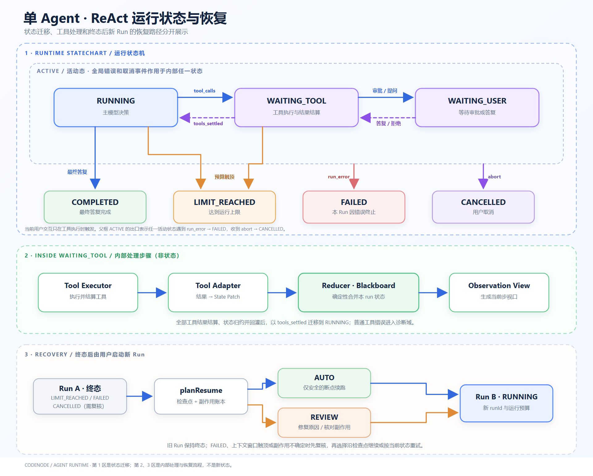
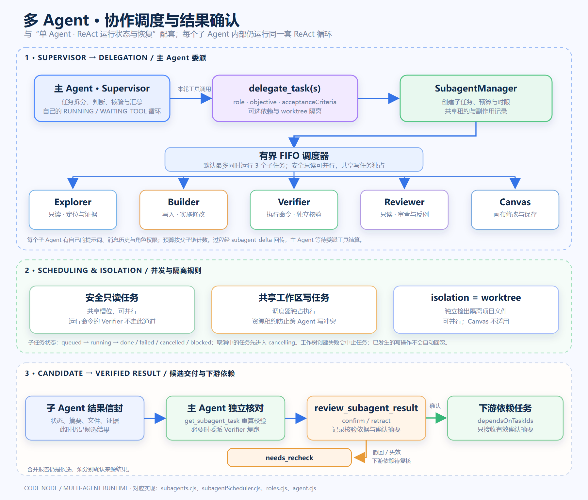

# CodeNode

**把本地代码工程、Agent 对话和可视化工作流放在同一个桌面窗口。**

[English](README.md) · [简体中文](README.zh-CN.md)

[](https://github.com/ZhuanTou33212/CodeNode/actions/workflows/ci.yml)
[](LICENSE)




CodeNode 是一个基于 Electron 和 React 的本地开发工作台。Agent 在桌面主进程中读取、检索和修改你打开的工程，画布负责组织任务、依赖和可以事后核对的运行记录。工程保存在单个 `.cnode` 文件里，源代码仍留在原目录。

**项目状态：** 1.0 之前的活跃开发版本，目前为单人维护。运行时依赖刻意保持很少——React、Zustand 和 `@xyflow/react`。

## 为什么是 CodeNode

多数 Agent 项目追求能力上限。CodeNode 还要求一次运行必须能挺过崩溃、取消或错误改动，并且不谎报结果：

- **可续跑的运行** —— 每次工具调用都落检查点，写入以规范参数的内容哈希为幂等键、作用域钉在原 Run 上：续跑跳过已提交的操作，并拒绝盲目重放结果未知的操作。→ [运行安全与恢复](docs/run-recovery.zh-CN.md)
- **可核对的委派** —— 子 Agent 的回答先是候选结果，声明的产物在进入下游前会与磁盘重新比对哈希。→ [多 Agent 协作](docs/multi-agent.zh-CN.md)
- **会失败的目标** —— 验收证据带文件指纹、提交和环境，条件一变即失效。→ [画布、工作流与目标](docs/canvas-and-goals.zh-CN.md)
- **可替换的后端** —— 自研 Agent 与外部 Agent 共用同一份 ACP v1 契约。→ [Agent 后端](docs/backends.zh-CN.md)

## 快速开始

需要 Node.js 22.12 或更新版本，以及可运行 Electron 的桌面环境（CI 用 `.nvmrc` 固定 22 系列）。

```powershell
git clone https://github.com/ZhuanTou33212/CodeNode.git
cd CodeNode
npm ci
npm run dev
```

`npm run dev` 会同时启动 Vite 和 Electron。已打包的 Windows 桌面版可直接运行 `release/win-unpacked/CodeNode.exe`；macOS 与 Linux 的打包目标已配置（`npm run dist:mac`、`npm run dist:linux`），但目前未作为发行版发布。

### 第一次使用

1. 选择**新建工程**、**打开工程**或**打开工程文件**——已有 `.cnode` 文件可以直接打开。
2. 在 **Agent → 管理模型…**选择供应商，粘贴 API Key，点击**获取模型**，再点**连接并使用**。无需手填模型 ID、API 地址、上下文或价格。
3. 先试只读任务，例如「找到项目入口文件，说明启动流程，并给出文件路径」。按 **Enter** 发送，**Shift+Enter** 换行。
4. 需要修改时说明范围和验收条件，查看工具调用，按界面提示处理需要确认的操作。运行中可以插话或停止。
5. 使用 **Ctrl+S** 保存工程；任务中断后，底部「运行」页会显示恢复计划。

## 核心能力

| 能力 | 说明 |
| --- | --- |
| 面向工程的 Agent | 读取、检索、编辑项目文件，执行获准的工具和命令，并展示调用过程。 |
| 单 Agent ReAct 运行 | 以一次 Run 为边界处理模型响应、工具调用、审批、取消、失败和预算终止。 |
| 可恢复的运行记录 | 保存事件、检查点和副作用账本；中断后区分可续跑步骤与需要复核的外部操作。 |
| 可视化工作流 | 用 `start`、`task`、`stage`、`tool`、`scope` 等节点组织任务和依赖。 |
| 多 Agent 分工 | 主 Agent 可委派探查、实现、验证和审查任务；结果经核对后才能传给下游。 |
| [兼容 Trellis](docs/trellis-compatibility.md) | 加载已有任务的 PRD 与规范、恢复任务/运行关联，并在预览与冲突检查后写回状态、日志和规范。 |
| 流式回复 | SSE 增量逐字呈现，可在常规设置中开关和调速。 |
| 可选项目检索 | 本地词法与结构检索源码和文档；向量检索、重排与严格答案校验按场景显式启用。 |
| 多模型接入 | 支持 OpenAI 兼容、Anthropic、Gemini、Azure 等端点及本地服务。 |

## 架构

一套 Agent 循环、一个 Run 边界、一条执行链：对话、画布和 Goal 自动推进都走它。检索保持本地且可选（BM25 + 可选向量），引用必须来自本轮实际读取的来源。





内部机制：[运行安全与恢复](docs/run-recovery.zh-CN.md) · [多 Agent 协作](docs/multi-agent.zh-CN.md) · [画布、工作流与目标](docs/canvas-and-goals.zh-CN.md)。

## 开发与验证

```powershell
npm run build       # TypeScript 检查、Vite 构建和图标检查
npm run check:js    # Electron 主进程与脚本的 JS 类型检查
npm test            # 核心回归测试（离线，无需显示环境）
npm run verify      # build + check:js + 核心测试
npm run dist:win    # Windows 打包；另有 dist:mac / dist:linux
```

| 位置 | 内容 |
| --- | --- |
| `src/` | React 界面、画布和状态管理 |
| `electron/` | 主进程：Agent 循环、工具、沙箱、检查点、成本 |
| `scripts/` | 回归与门禁脚本；`npm run test:list` 打印当前集合 |
| `docs/` | 设计说明、架构图片和评测数据 |

执行器：自研 CodeNode Agent，以及 Codex、DeepSeek Harness、Hermes、OpenCode、OpenClaw 和自定义 ACP Agent，统一走 ACP v1 stdio（[详见](docs/backends.zh-CN.md)）。

测试理念、门禁清单与发布流程见[参与开发](CONTRIBUTING.zh-CN.md)。

## 许可证

[MIT](LICENSE)
