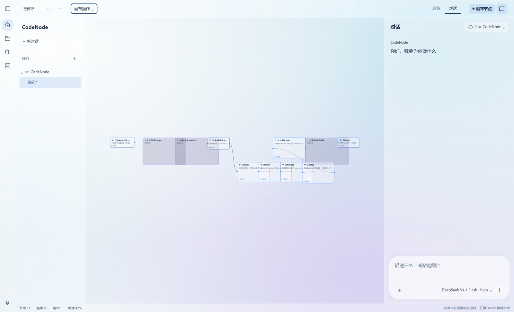

# 画布、工作流与目标

[English](canvas-and-goals.md) · [简体中文](canvas-and-goals.zh-CN.md)

画布是真的工作流引擎，不是画板：执行状态由主进程持久化，同一个工程文件同时承载图、会话和目标记录。

## 画布

- 可见图层使用 Canvas 2D；节点选择、拖拽、连线命中、缩放及键盘操作由透明的交互层处理。
- 选中图像、对象、范围或内嵌矢量画布节点时，其编辑控件临时显示在图层上方。
- 保存格式仍是节点与边的数据，不依赖屏幕像素。「显示全部节点」会把所有节点装进画布视口。
- 在空白画布按 **Shift+A** 添加节点，最小可运行链路是 `start → task → end`。选中节点填写目标，再从节点端口连线。
- 顶部「运行」打开底部面板，在「连续执行」页启动工作流。「数据流」只计算节点输入和输出。

画布工作流按节点连线组织执行顺序；对话任务则由 Agent 根据当前项目和可用工具执行。两者可以在同一工作台中使用，但画一个 `stage` 节点不会自动启动子 Agent。节点执行与对话走同一条运行链（见[运行安全与恢复](run-recovery.zh-CN.md)）：节点执行前先落盘为 `prepared`，并对图版本做一次比较交换。

## 规划工作流

在对话框输入 `/plan 任务目标`，CodeNode 会用内置规划模型只读生成步骤，并在当前画布中建立可编辑的任务节点与依赖连线；生成后由用户检查，点击「连续执行」才开始运行。

已有 Agent `update_plan` 计划也可从计划卡点击「生成可编辑工作流」导入一次；之后对画布的修改不会被计划卡覆盖。

## 目标

输入 `/goal 目标描述` 会打开目标表单，先补充至少一条可核对的验收条件并创建 Goal；CodeNode 随后自动生成待确认的任务图预览，确认后才写入 Goal。

- 目标详情中的「任务图」直接展示 `.codenode/goals.json` 的 Task 与 `dependsOn`，也可手工增加、编辑和连线。
- 节点详情可以选择本阶段负责的 Goal 验收条件：未绑定整体条件的中间任务只提交本阶段证据，最终验收任务承接整体条件。
- 点击节点可看 Agent 留下的阶段总结及当前验收证据；只有未运行、无下游依赖的 Task 能删除，已有 Run 或证据的 Task 保留历史。
- 点击「开始执行 Goal」会按 Goal 原有的准入、预算、写入范围、结算和证据规则逐个执行，遇到等待、失败、证据不足或需要人工复核即停止后续阶段。
- 验收证据带来源指纹、提交和环境；文件或条件一变，证据即失效。不会凭模型自述把 Goal 标成完成。
- 规划模型与执行时选择的 Agent 后端分别配置（见[后端](backends.zh-CN.md)）。

### 总览页

工作台顶部 **总览／对话** 按钮切换两张独立页面。总览采用简短项目简报、待处理事项与单列目标列表；无目标时不显示统计卡或常驻表单，点击新建或目标条目后才打开编辑窗口。对话页保留画布与聊天，仅在绑定任务时显示简短目标提示。

两页都保持挂载，来回切换保留消息、输入草稿、画布、模型和未保存的目标表单。当前页面持久化于共用 UI 配置，也可在设置 → 常规 → 默认工作台调整。

## 节点删除

点击节点标题或边框后按 Delete／Backspace／X 删除整个节点；Ctrl+Z 撤销。

- 节点内部有图形选中时，Delete 只删图形；点击内部空白且只选中外层节点时，Delete 删除整节点。
- 删完图形会清理外层选区，避免连续按键误删整节点；输入框与目标管理控件聚焦时不会删除画布节点。
- 底部状态栏显示实际多选数量和当前删除对象；新增、加载、撤销和重做会同步视觉选区与实际选区。

`npm run test:workspace-ux-ui` 使用实际鼠标与键盘事件验证上述行为；打包验收证据见 [acceptance.json](validation/workspace-ux-preview/acceptance.json)。效果：[夜间](validation/simple-overview-preview/dark.png) · [日间](validation/simple-overview-preview/light.png)。

## 检索与工程存储

本地 Agentic RAG 为项目文件建立 BM25 索引，可选向量后端（默认进程内 `memory`；也可以配置 SQLite 或 Milvus）。检索命中只帮助定位，引用仍需对应本轮实际读取的来源。设置入口在底部工作台的「检索设置」页。

工程容器 `.cnode` 保存画布、会话、工作区和完整性信息；`.codenode/` 保存项目级运行记录、索引和标量数据。模型列表保存在 Electron 用户数据目录，API Key 需要系统安全存储可用。
