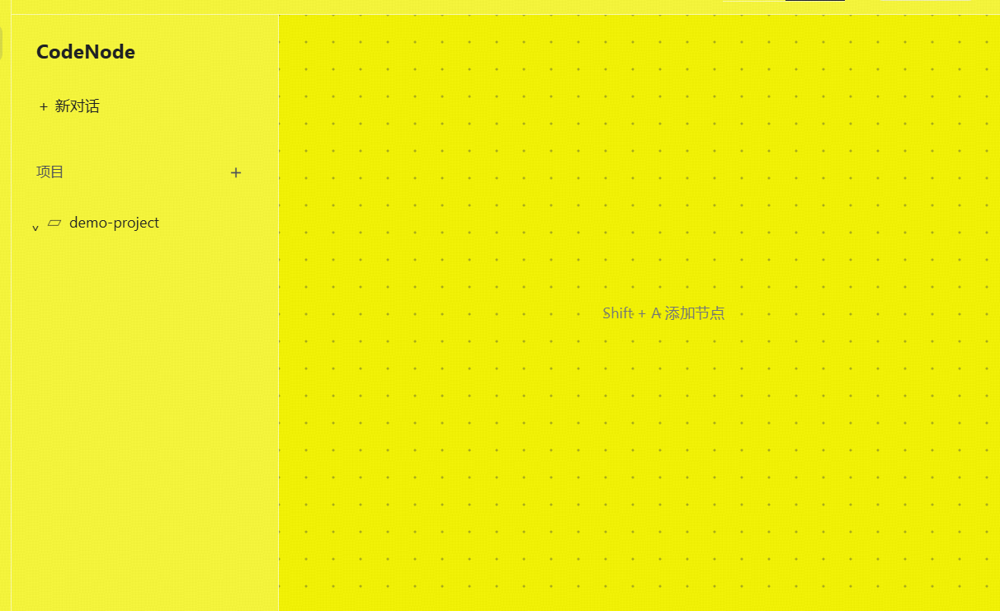
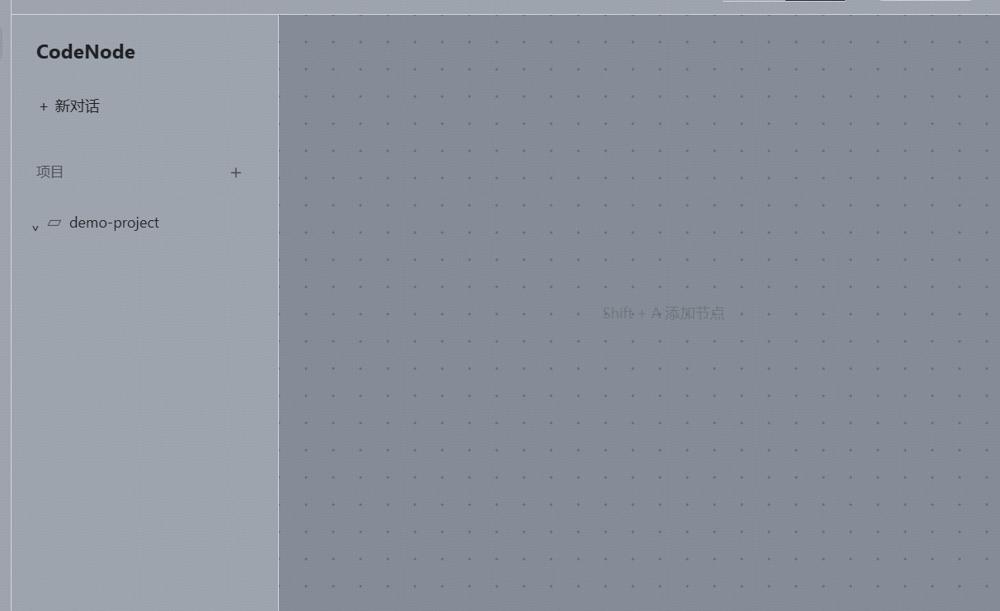

# 主题：日间 / 夜间 / 透明玻璃

外观设置里提供三套皮肤：**日间**、**夜间**、**透明玻璃**。三套主题共用同一套控件结构、布局与交互逻辑，
差异只由 `config/ui.themes.json` 里的配色变量表达；切换主题不会重置会话、输入草稿、模型选择或侧栏状态。

「透明玻璃」是纯透明无色的玻璃皮肤：窗口底色换成系统级玻璃材质，**桌面内容真实透出**并被系统模糊，
界面本身保持明亮通透。




（两张证据图由 `npm run test:glass-theme-ui` 在真实屏幕合成结果上截取：同一块窗口区域，背后分别放纯亮黄与近黑底，
用于证明“界面确实透光”而不是“画成了浅色”。）

## 为什么必须动用原生窗口材质

渲染层能做的只有 `backdrop-filter`，而在 Electron 透明窗口里，**CSS 的模糊摸不到桌面**：
实测「透明窗口 + `backdrop-filter: blur(28px)` 面板」与「透明窗口 + 纯半透明色块」的屏幕像素**逐点一致**
（亮度均值同为 245.75、标准差同为 26.50），说明模糊只作用于页面自身内容。

结论：桌面透亮只能来自窗口材质，必须由主进程设置。

## 实测确定的窗口配置（Windows 11 23H2 / Electron 44）

在真实屏幕上逐项测量同一块区域（亮黄与近黑两种桌面背景下取像素统计）：

| 窗口配置 | 亮度均值 | 标准差 | 判定 |
| --- | --- | --- | --- |
| 不透明底色（对照组） | 107.01 | 1.47 | 完全不透明 |
| 有边框 + 透明底色 + `acrylic` | 221.66 | 2.81 | **亚克力磨砂玻璃，桌面透出** |
| 有边框 + 透明底色 + `mica` | 240.33 | 1.48 | 生效但极淡 |
| 有边框 + 透明底色 + 无材质 | 240.00 | 1.47 | 不透明（白底） |
| 无边框 + `transparent` + 无材质 | 242.92 | 35.85 | 完全透明（与桌面像素一致） |

由此确定三条关键结论：

1. **`backgroundMaterial: 'acrylic'` 在有边框窗口上同样生效** —— 不需要改成无边框窗口，
   不需要自绘标题栏，昼夜主题的窗口外观与行为完全不受影响。
2. **底色与材质都能在运行时切换**：造窗时不透明深色 → 运行时 `setBackgroundColor('#00000000')` +
   `setBackgroundMaterial('acrylic')`，结果与一开始就建玻璃窗口**逐像素一致**（均值同为 221.86）。
   因此切换主题不需要重建窗口，也就不会打断正在进行的会话。
3. **材质明暗跟随 `nativeTheme.themeSource`**：`dark` 是石墨灰（均值 143.22），`light` 才是无色的明亮玻璃（221.86）。
   玻璃主题因此强制 `light`，离开玻璃主题时恢复 `system`。

## 实现位置

- `electron/theme.cjs`：主题 → 窗口材质。负责读取/持久化主题、建窗参数、运行时施加材质，
  并在最大化和还原等时机补施一次（DWM 在这些时机可能丢弃材质）。
- `electron/main.cjs`：建窗时使用 `windowTheme.windowOptions()`，并 `bindWindow` 该窗口。
- `electron/preload.cjs` / `src/global.d.ts`：暴露 `window.codenode.applyTheme(theme)`。
- `src/App.tsx`：主题变化时写 `html[data-theme]`、`color-scheme` 与全部 CSS 变量，并上报主进程。
- `src/lib/theme.ts`：主题 ID、标签、校验与 token 读取的唯一来源（主进程直接读 `config/ui.themes.json` 的键）。
- `config/ui.themes.json`：三套主题的色值。
- `src/styles.css`：`html[data-theme="glass"]` 下 `html/body/#root` 必须整体透明，否则会盖住桌面玻璃。

## 「无色」是硬约束

除语义状态色（`--stage-*`）与危险色（`--menu-danger`）外，玻璃主题的每个色值都必须是无彩色的
（RGB 极差 ≤ 12）。这条约束由 `test:glass-theme-ui` 直接断言，避免以后顺手加回偏蓝的灰。

## 验收

```
npm run test:glass-theme-ui
```

这条用例跑真实 `main.cjs`、真实 preload 与构建产物，断言：

- 三套主题 token 键完全一致（缺键会在切换后残留上一套色值）；
- 设置入口是「日间／夜间／透明玻璃」三选一，选中态唯一且持久化到 `localStorage`；
- 玻璃主题下窗口底色变为全透明、`color-scheme` 为亮色、`.app`/`body`/`#root` 计算背景为透明；
- **透光率**：把窗口背后的底色从纯亮黄换成近黑，玻璃主题下 99.8% 的像素亮度变化（均值差 69.3），
  夜间主题下变化 0%（均值差 0，均值 35.69）—— 后者同时是对照组，证明取样区确实是应用本体；
- 切换主题不重置工程、消息、偏好、侧栏与工作台状态；
- 切回夜间后窗口底色恢复不透明，`nativeTheme.themeSource` 恢复 `system`。

## 边界

- 只有 Windows 能真正透出桌面。其它平台（以及无法设置材质的 Windows 环境）退化为不透明亮色玻璃底，
  界面与交互完全一致，只是不穿透桌面。
- 系统开启「减少透明度／高对比度」时，`prefers-reduced-transparency` 规则会把玻璃面板回退为不透明底色。
- 材质不可用时保持上一次底色，界面仍可正常使用（`applyToWindow` 不会抛错打断切换）。
