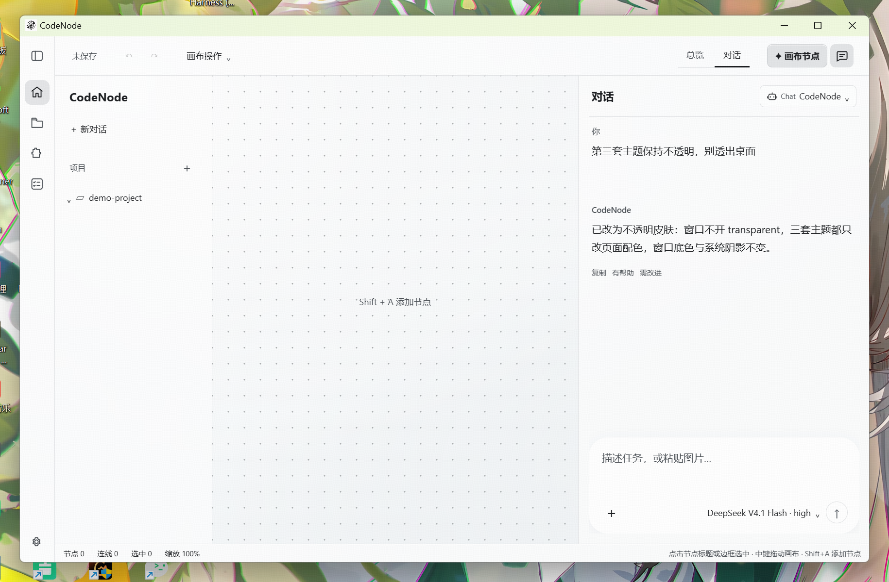
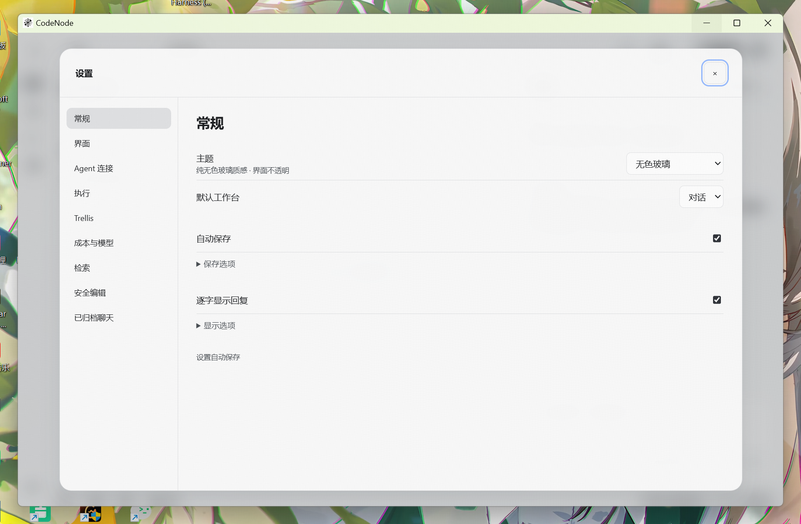

# 主题：日间 / 夜间 / 无色玻璃

外观设置（设置 → 常规 → 主题）用**下拉框**提供三套皮肤：**日间**、**夜间**、**无色玻璃**。
三套主题共用同一套控件结构、布局与交互逻辑，差异只由 `config/ui.themes.json` 里的配色变量表达；
切换主题不会重置会话、输入草稿、模型选择或侧栏状态。

**三套主题都是不透明皮肤，都不穿透桌面。** 窗口不开 `transparent`，保留系统标题栏与外阴影；
主题只改页面内的配色变量，完全不碰窗口本身。




## 「无色玻璃」是什么

一种**纯无色**的亮色玻璃质感皮肤：靠层叠出玻璃感，而不是靠透明。

- 底色是不透明的亮色中性渐变（`--bg` / `--glass-base` = `#eef1f4`，有不透明兜底色）；
- 上面叠一层白色薄膜（面板 0.72、控件 0.66、菜单与对话框 0.94），靠薄膜与内高光造出玻璃层次；
- 除语义状态色（`--stage-*`）与危险色（`--menu-danger`）外，**每个色值都不得有可见色偏**
  （RGB 极差 ≤ 12），这条由 `test:bright-theme-ui` 直接断言，避免以后顺手加回偏蓝的灰。

| token | 值 | 覆盖的表面 |
| --- | --- | --- |
| `--app-background` | 亮色中性渐变（不透明白底） | 画布 / 工作区底 |
| `--gate-background` | 亮色中性渐变（不透明白底） | 启动门禁页 |
| `--glass-surface` | `rgba(255,255,255,.72)` | 工具栏、侧栏、对话栏、图标栏、节点卡片 |
| `--glass-control` | `rgba(255,255,255,.66)` | 输入框、按钮、控件 |
| `--glass-sheet` | `rgba(255,255,255,.94)` | 菜单、对话框、计划卡 |

## 为什么不透明：一次实测后的回退记录

这个位置最初放的是**真透明**皮肤（桌面透出）。三版都在这台机器（Windows 11 23H2 / Electron 44 / 150% 缩放）
上用真实屏幕像素量过，取样区背后放高频棋盘格（棋盘格自身标准差 123.51）：

| 实现 | 取样区标准差 | 与棋盘格结构相关性 | 结果 |
| --- | --- | --- | --- |
| 系统材质 `acrylic` | 2.35 | ~0 | 桌面结构全丢，只剩一片灰 → 被否（「灰蒙蒙」） |
| 系统材质 `mica` | 1.48 | ~0 | 同样糊 |
| 真透明 + 半透明白膜（画布 .68–.74） | 33.7 | 0.614 | 桌面清晰可辨，但**桌面内容与界面抢注意力** |
| 不透明皮肤（现状） | 11 | — | 完全不透，界面自成一体 |

回退的直接原因：透明版在桌面放着文档、IDE 或聊天窗口时，别人的正文会与界面自己的文字挤在一起，
启动门禁页尤其明显（用户截图确认）。主界面是长时间盯着干活的地方，**可读性优先于透明**。
顺带排除的两个方案：「用 CSS 模糊桌面」做不到（`backdrop-filter` 的模糊只作用于页面自身内容，
实测 `blur(28px)` 面板与纯半透明色块的屏幕像素逐点一致：均值 245.75、标准差 26.50）；
「透明窗口 + 系统材质」又会糊成灰雾。透明窗口还会丢掉 DWM 外阴影（外扩 10dip 亮度差 8.57 → 0，
`hasShadow` 补不回来），不透明方案连这个代价也一并省掉。

因此现在：**窗口层不做任何特殊处理，玻璃感全部由页面内的配色与薄膜层叠表达。**

## 实现位置

| 文件 | 职责 |
| --- | --- |
| `src/lib/theme.ts` | 主题 ID、标签、提示、校验与 token 读取的唯一来源 |
| `config/ui.themes.json` | 三套主题色值 |
| `src/components/GlobalSettings.tsx` | 主题下拉框（`select[data-theme-select]`） |
| `src/store/uiStore.ts` | 主题状态与持久化（`localStorage` 的 `codenode.theme`） |
| `src/App.tsx` | 写 `html[data-theme]`、`color-scheme` 与全部 CSS 变量 |
| `electron/main.cjs` | 窗口固定不透明底色 `#14161a`，不设 `transparent` |

主题状态只存在渲染层（`localStorage`），主进程不参与，因此切换主题不需要 IPC、不需要重建窗口。

## 验收

```
npm run test:bright-theme-ui
```

跑真实 `main.cjs`、真实 preload 与构建产物：

- 三套主题 token 键完全一致；第三套无色（RGB 极差 ≤12）且有不透明兜底色；
- 设置入口是 `select` 下拉框（日间／夜间／无色玻璃），没有横排按钮；
- 窗口底色在三套主题下都保持不透明 `#14161A`；
- **像素级不透明**：窗口背后放高频棋盘格（参照标准差 123.51），三套主题的取样区标准差都必须 ≤20
  （实测 日间 11.2 / 夜间 11.0 / 无色玻璃 11.8），且与棋盘格均值差 >40 —— 任何一套漏出桌面内容都会失败；
- 切换主题保留工程、消息、偏好、侧栏与工作台状态，并把选择持久化。

包内验收：`CODENODE_UI_TEST_PACKAGE=<交付包根目录> npm run test:bright-theme-ui`
（`packaged-ui-check` 另外断言 asar 内三套色值、第三套不透明底色、**打包主进程不使用透明窗口**、
渲染包包含第三个主题入口且没有整页透明规则）。
