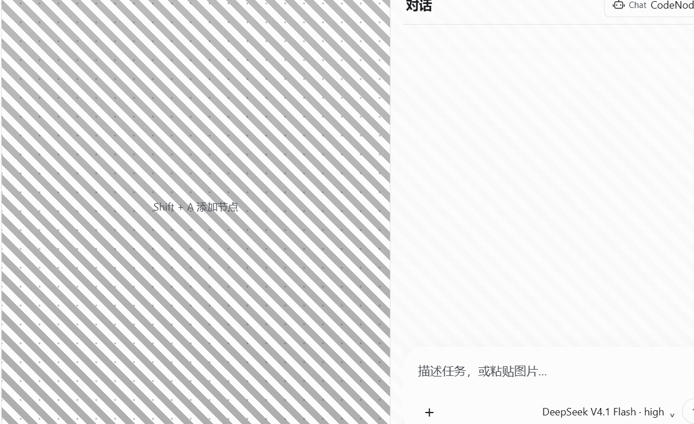

# 主题：日间 / 夜间 / 透明玻璃

外观设置（设置 → 常规 → 主题）用**下拉框**提供三套皮肤：**日间**、**夜间**、**透明玻璃**。
三套主题共用同一套控件结构、布局与交互逻辑，差异只由 `config/ui.themes.json` 里的配色变量表达；
切换主题不会重置会话、输入草稿、模型选择或侧栏状态。

「透明玻璃」是纯透明无色的玻璃皮肤：窗口真实透明，**桌面内容直接透出**，界面本身保持明亮无色。





## 关键实测：桌面透亮只可能来自窗口层面

三条结论都是在这台机器（Windows 11 23H2 / Electron 44 / 150% 缩放）上用真实屏幕像素量出来的，
取样区背后放**高频棋盘格**：桌面结构保住多少，看标准差与相关性即可判定。

| 窗口配置 | 取样区标准差 | 与棋盘格的结构相关性 | 结论 |
| --- | --- | --- | --- |
| 棋盘格自身（参照） | 123.51 | 1.000 | — |
| 有边框 + 透明底色 + 无系统材质 | **123.51** | 1.000 | **逐像素原样透出，锐度零损失** |
| 有边框 + 透明底色 + `acrylic` | 2.35 | ~0 | 糊成一片灰雾 ← 「灰蒙蒙」的来源 |
| 有边框 + 透明底色 + `mica` | 1.48 | ~0 | 同样糊，更淡 |
| 有边框 + 透明底色 + 无材质且未开 `transparent` | 1.47（不透明白底） | — | 不透明 |

另外两条同样重要的实测：

1. **CSS 的 `backdrop-filter` 模糊不到桌面**。透明窗口 + `blur(28px)` 面板与透明窗口 + 纯半透明色块，
   屏幕像素逐点一致（均值同为 245.75、标准差同为 26.50）：模糊只作用于页面自身内容。
   所以「桌面模糊/透亮」只能在窗口层面决定，CSS 只能叠加薄膜。
2. **`transparent: true` 在有边框窗口上同样生效**（Electron 44 实测），因此不需要无边框、
   不需要自绘标题栏，昼夜主题的窗口外观与标题栏完全不变。

## 实现

- 窗口一律按透明能力创建：`transparent: true`（建窗期选项，运行时改不了）。
- 玻璃主题把窗口底色设为全透明 `#00000000`；昼夜主题保持不透明底色 `#14161a`。
- 页面自己负责薄膜：`html[data-theme="glass"]` 下 `html/body/#root` 整体透明，
  由 `.app` 的 `--app-background` 铺一层**半透明白膜**。
- 主题 ID 直接取自 `config/ui.themes.json` 的键，主进程与渲染层不各维护一份列表。

模块分工：

| 文件 | 职责 |
| --- | --- |
| `electron/theme.cjs` | 主题 → 窗口透明度：读取/持久化主题、建窗参数、运行时施加底色 |
| `electron/main.cjs` | 用 `windowTheme.windowOptions()` 建窗，并 `bindWindow` 该窗口 |
| `electron/preload.cjs` / `src/global.d.ts` | 暴露 `window.codenode.applyTheme(theme)` |
| `src/App.tsx` | 主题变化时写 `html[data-theme]`、`color-scheme` 与全部 CSS 变量，并上报主进程 |
| `src/lib/theme.ts` | 主题 ID、标签、提示、校验与 token 读取的唯一来源 |
| `config/ui.themes.json` | 三套主题色值 |
| `src/components/GlobalSettings.tsx` | 主题下拉框（`select[data-theme-select]`） |

## 为什么画布也要一层白膜

纯粹 0% 薄膜（`--app-background: transparent`）确实最「透」，但代价是无法使用：
桌面上的任意高对比内容（文档、IDE、聊天窗口）会和界面自己的文字抢注意力，
画布上的节点与提示会淹没在别人的正文里。

因此玻璃主题的底色是一层**半透明白膜**：画布 0.68–0.74，文字面更实（见下），
桌面结构保住约 27%（相关性 0.61）——足以看清壁纸的颜色与形状，又不会喧宾夺主。
这就是「透亮」与「可用」的平衡点：

| token | 值 | 覆盖的表面 |
| --- | --- | --- |
| `--app-background` | `linear-gradient(rgba(255,255,255,.74),rgba(255,255,255,.68))` | 画布 / 工作区底 |
| `--gate-background` | `linear-gradient(rgba(255,255,255,.76),rgba(255,255,255,.70))` | 启动门禁页 |
| `--glass-surface` | `rgba(255,255,255,.88)` | 工具栏、侧栏、对话栏、图标栏、节点卡片 |
| `--glass-control` | `rgba(255,255,255,.82)` | 输入框、按钮、控件 |
| `--glass-sheet` | `rgba(252,253,255,.94)` | 菜单、对话框、计划卡 |

文字面取 0.82 以上，是为了在最坏情况（纯黑壁纸）下也守住对比度底线：
正文 ≥11:1、次要文字 ≥6:1、最弱提示 ≥5:1。

## 「无色」是硬约束

除语义状态色（`--stage-*`）与危险色（`--menu-danger`）外，玻璃主题的每个色值都必须是无彩色的
（RGB 极差 ≤ 12）。这条约束由 `test:glass-theme-ui` 直接断言，避免以后顺手加回偏蓝的灰。

## 已知取舍

1. **窗口失去 DWM 外阴影**：`transparent: true` 的窗口不再有系统投影
   （外扩 10dip 实测亮度差 8.57 → 0），`hasShadow` 也补不回来。这是三套主题共担的一处损失，
   换来玻璃主题可随时切换而无需重建窗口（重建会打断进行中的会话，不可接受）。
2. **「透明 → 不透明」不可逆**：`setBackgroundColor('#00000000')` 在透明窗口上确实生效，
   但反向设回不透明色在 Windows 上不生效，且 `getBackgroundColor()` 的回报不可信
   （同一调用先后回报 `#FFFFFF` / `#000000`）。因此实现只在需要透明时动窗口，
   昼夜主题的不透明底由页面自己画——两者视觉等价。
3. 只有 Windows 支持真实透明（DWM）。其它平台窗口保持不透明底色，玻璃主题退化为
   「明亮无色的半透明界面」，结构与交互完全一致，只是不穿透桌面。
4. 系统开启「减少透明度／高对比度」时，`prefers-reduced-transparency` 规则会把玻璃面板回退为不透明底色。

## 验收

```
npm run test:glass-theme-ui
```

跑真实 `main.cjs`、真实 preload 与构建产物，断言：

- 三套主题 token 键完全一致、玻璃主题色值无色、底色是 0.4–0.8 的半透明白膜；
- 设置入口是 `select` 下拉框（三个选项：日间／夜间／透明玻璃），没有横排按钮；
- 玻璃主题下窗口底色全透明、`color-scheme` 为亮色、`.app`/`body`/`#root` 计算背景透明，且持久化到主进程；
- **透亮实测**：窗口背后放高频棋盘格，玻璃主题取样区的标准差保住 ≥18%（实测 27.3%）、
  与棋盘格的结构相关性 ≥0.4（实测 0.614）；一旦退回系统材质磨砂，两者会塌到个位数百分比与 ~0；
- 对照组：昼夜主题在同样棋盘格背景下标准差 ≤20（实测 10.7 / 11.0），证明取样区确实是应用本体；
- 切换主题不重置工程、消息、偏好、侧栏与工作台状态；切回夜间后像素层面重新完全不透明。

包内验收：`CODENODE_UI_TEST_PACKAGE=<交付包根目录> npm run test:glass-theme-ui`
（`packaged-ui-check` 另外断言 asar 内的主题模块、色值、preload IPC 与渲染包入口）。
